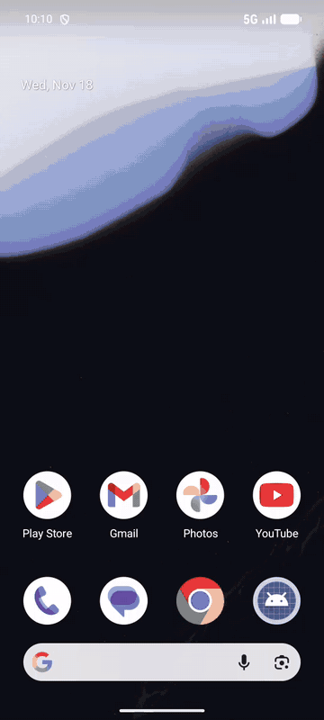
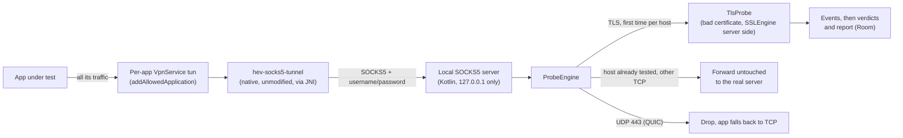

# TrustProbe

**An Android app that tests, on the phone itself, whether another app really validates TLS certificates. No root, no installed CA, no external server.**

[](https://github.com/leemikepop/TrustProbe/actions/workflows/ci.yml)



*Recorded on an emulator against the in-repo testbed app: start a session, run the testbed's four HTTPS clients, stop, read the per-host verdicts with masked evidence.*

## The problem

Apps that validate TLS certificates wrongly (a `TrustManager` that accepts everything, a `HostnameVerifier` that always returns true; CWE-295) let anyone on the same Wi-Fi read credentials and tokens. The Okara study (arXiv [2601.22770](https://arxiv.org/abs/2601.22770)) analysed 37,349 Android apps and found 22.42% (8,374) vulnerable to TLS man-in-the-middle attacks, with about 41% of the vulnerabilities attributed to third-party libraries.
Earlier tools each needed something extra: Marvin needs root and instrumentation, nogotofail needs a router or gateway you control (and is archived), Okara is a research pipeline built on an external server and cloud emulators, and jsparber/interceptor is an unmaintained prototype.

TrustProbe is one APK. Pick an app on your own phone, start a time-boxed session, use that app for a few minutes, and get a report with one verdict per host name and evidence for each.

## How it works



Two observations make the design small:

1. **Accepting a certificate does not require forwarding traffic.** TrustProbe is itself the TLS server and presents a bad certificate. If the client completes the handshake and sends application data, it accepted the certificate. If it sends an alert or closes, it rejected it. The first request an accepting client sends is the evidence (method, host, path, header names), so no decrypting proxy is needed.
2. **No guessing which app a packet belongs to.** `VpnService.Builder.addAllowedApplication(pkg)` routes only the app under test through the tunnel, so everything in the tun belongs to it. TrustProbe's own sockets are outside the VPN, so nothing needs `protect()`.

Modules: `:core` (pure Kotlin/JVM: SOCKS5 server, ClientHello parser, certificate factory, `TlsProbe`, scheduler, verdicts, redaction, reports; unit-testable without a device), `:app` (VpnService, JNI glue, Room, Compose UI), `:testbed` (ground-truth app).

## Design decisions

- **No mitmproxy, no Python layer.** Deciding "did the client validate?" only needs the server side of one handshake. Dropping a decrypting proxy removes an interpreter, a large dependency tree and a lot of moving parts; the native code in the APK is about 350 KB per ABI (hev) and there is no Python runtime.
- **A single-app VPN.** Attribution is by construction, not by heuristics, and a tested app that correctly rejects the forged certificate only breaks for that one app and only for the session. Sessions are time-boxed (default 5 minutes) for the same reason.
- **Adaptive, T2-first schedule.** Many correct apps give up after one refusal, so TrustProbe cannot assume three attempts. Per host name it runs `T2_UNTRUSTED_CA` first (closest to a real attacker, and alone answers "is the chain checked?"). If rejected, `T1_SELF_SIGNED` runs next on a retry; if accepted, `T3_WRONG_HOST` runs next to gauge severity. After that the host is forwarded untouched so the app recovers. Each case yields at most one decisive result (a timed-out or errored attempt is retried once); verdicts count only the cases that actually ran, and the report lists them.
- **Verdicts are recomputed from events.** The engine only emits an append-only log of what happened (`Probed`, `Forwarded`, `QuicDropped`). Verdicts are a pure function of that log, so the live screen, the saved report, the history view and the exports always agree, and the verdict logic is tested without any network.
- **Masking by default.** Header values and query values are reduced to their first 4 characters plus `…` and a length (for example `Authorization: Bear… (length 212)`; values of 4 characters or fewer are masked completely), body content is never recorded, and unmasked content exists only in memory for the current session and is never stored or exported.
- **Hardened local proxy.** The SOCKS5 server listens on 127.0.0.1 with per-session random credentials, so other apps on the device cannot use it to bypass the VPN.

## Test cases and verdict rules

| Case | Certificate presented | A correct app should | If accepted, it means |
|---|---|---|---|
| `T1_SELF_SIGNED` | Self-signed, correct host name | Reject | Trust chain not checked |
| `T2_UNTRUSTED_CA` | Signed by a throwaway local CA, correct host name | Reject | Trust chain not checked (any chain accepted) |
| `T3_WRONG_HOST` | Throwaway local CA, wrong host name | Reject | Neither chain nor host name checked |

The local CA is generated per session and never installed, so a correct app rejects all three.

Per host name:

- **VULNERABLE**: any case was accepted. Severity: `ACCEPTS_ANY_CERT` if T3 was accepted, `NO_CHAIN_VALIDATION` if only T2 was, `ACCEPTS_SELF_SIGNED` if only T1 was. Evidence is the first request, masked.
- **PASS**: T2 was clearly rejected (alert, close during the handshake, or close right after it without sending data). The report notes when T1 was not run. Apps that pin certificates also land here, which is correct.
- **INCONCLUSIVE**: no connections, only timeouts or errors, or no SNI (so no correct-name certificate can be made). The reason is stated.

The app-level result is VULNERABLE if any host is; otherwise PASS if at least one host passed; otherwise INCONCLUSIVE (hosts without a decisive result do not downgrade a PASS).

## Results

The in-repo testbed has four HTTPS clients with known behaviour. Figures were measured on an emulator (API 37, x86_64) and on a Pixel 7; the Pixel 7 column is one Pixel 7 (Android 17) on home Wi-Fi, one run of the same methods. Raw notes and how each number was taken: [`docs/measurements.md`](docs/measurements.md).

| Metric | emulator (API 37, x86_64) | Pixel 7 (real device) |
|---|---|---|
| Testbed verdicts correct | 4/4 (also asserted in CI on an API 35 emulator) | 4/4 in 3 of 3 sessions |
| Testbed launch (autorun) to all four hosts tested, including app cold start and retries (median of 3) | 3.8 s | 3.1 s (3.0 / 2.9 / 3.2) |
| Probe duration, `Probed.result.durationMs` (median of 24) | 9 ms (rejected 6 ms; accepted 219 ms, which includes waiting for the first request) | 15 ms (rejected 11 ms; accepted 227 ms, which includes waiting for the first request) |
| Testbed `elapsedMs` for one OkHttp request to the CORRECT host: no TrustProbe vs. forward mode (median of 20 each) | 521 / 548 ms (two blocks) vs. 441 ms (one session, n = 20). Emulator noise exceeds any effect, so this shows no detectable slowdown, not that forwarding is free or faster | 244 / 246 ms (two blocks) vs. 331 ms (one session, n = 20): forward mode is consistently about 85 ms slower per fresh connection plus request on this device; the split between hops was not measured |
| Release APK size (unsigned, no R8, arm64-v8a + x86_64) | 31.9 MB | 31.9 MB (same build) |

Testbed ground truth: `CORRECT` (default OkHttp) PASS; `TRUST_ALL` (trust-everything manager and host name verifier) VULNERABLE / `ACCEPTS_ANY_CERT`; `HOSTNAME_VERIFIER_ALWAYS_TRUE` (chain still checked) PASS in v1; `PINNED` PASS.

## Limitations

- **Only TCP 443 is probed.** Other ports are forwarded untested, and connections without SNI are forwarded, not probed.
- **QUIC is dropped.** UDP 443 is discarded so apps fall back to TLS over TCP; HTTP/3-only traffic is not tested.
- **No SNI means INCONCLUSIVE.** Without a server name no certificate with the right name can be made.
- **A valid chain with the wrong host name is not detectable in v1.** That bug needs a certificate the device trusts for another name (planned `T4`). The testbed's `HOSTNAME_VERIFIER_ALWAYS_TRUE` client is PASS today on purpose.
- **IPv6 is routed only when the underlying network has global IPv6.** Otherwise the tunnel is IPv4-only.
- **Masking covers header values and query values only.** Path segments and query keys are kept as they are, so a secret placed in a path (`/reset/<token>`) would appear in a report. Treat reports as sensitive.
- **Only the first request is kept as evidence** per accepted connection.
- **Small samples.** Numbers come from one emulator and one Pixel 7 on Wi-Fi (3 sessions, one forward-mode session of 20 requests); treat them as indicative.
- Ground truth is the testbed. Detection of known-vulnerable real-world apps has not been validated yet (see the roadmap).

## Responsible use

Test only apps on your own device. TrustProbe tests the client's behaviour and never attacks servers. While a session runs, the tested app's first connections to each host fail on purpose (a correct app refuses the forged certificate), so use short sessions. If you find a vulnerable app, report it to the vendor through responsible disclosure before saying anything publicly. This README never names third-party apps, and results about real apps should not be published without disclosure.

## Build & test

```bash
git clone --recurse-submodules https://github.com/leemikepop/TrustProbe.git
# already cloned: git submodule update --init --recursive
```

Requirements: JDK 17+ (CI uses 21), Android SDK platform 37, NDK `30.0.14904198` (the native code is built with ndk-build; no CMake needed).

```bash
./gradlew :core:test :app:testDebugUnitTest :app:assembleDebug :testbed:assembleDebug lint
./gradlew :app:assembleRelease    # unsigned release APK
# end-to-end on a running emulator or device (installs the testbed first):
./gradlew :testbed:installDebug :app:connectedDebugAndroidTest \
  -Pandroid.testInstrumentationRunnerArguments.class=io.github.leemikepop.trustprobe.e2e.TestbedVerdictsTest
```

CI (`.github/workflows/ci.yml`) runs the build, unit tests and lint on every push and pull request, and the end-to-end test on an API 35 emulator for pushes to `main` and manual runs.

## Roadmap

1. Validate the verdicts on older APKs of apps with publicly known CWE-295 issues (responsible disclosure for anything new).
2. `T4_TRUSTED_WRONG_HOST`: with a certificate for your own domain, detect "chain checked, host name not checked".
3. Cleartext HTTP detection while forwarding port 80 (masked, same rules).
4. Server-side checks in forward mode: the real server's chain, TLS version, revocation.
5. A write-up of the design decisions (why no mitmproxy, why a per-app VPN).

## Third-party components & licenses

| Component | License | Use |
|---|---|---|
| [hev-socks5-tunnel](https://github.com/heiher/hev-socks5-tunnel) (with hev-socks5-core) | MIT | git submodule, unmodified, native tun-to-SOCKS5 |
| [hev-task-system](https://github.com/heiher/hev-task-system) | MIT | inside the hev-socks5-tunnel submodule |
| [lwIP](https://github.com/heiher/lwip) | BSD-3-Clause | inside the hev-socks5-tunnel submodule (TCP/IP stack) |
| [yaml](https://github.com/heiher/yaml) (a branch of libyaml) | MIT | inside the hev-socks5-tunnel submodule (config parsing) |
| Bouncy Castle (`bcpkix`, `bcprov`) | Bouncy Castle License (MIT-style) | generating test certificates |
| OkHttp | Apache-2.0 | testbed app only |
| AndroidX, Jetpack Compose, Room, Kotlin, kotlinx libraries | Apache-2.0 | app and core |

Versions, commits and the full notice texts: [THIRD_PARTY_NOTICES.md](THIRD_PARTY_NOTICES.md). TrustProbe itself is MIT licensed ([LICENSE](LICENSE)).

## Background

This is a public follow-up to a private university research prototype on mobile threat defense. It shares no code, data or infrastructure with that project; it was written from scratch around a different question (does this app validate certificates?).
